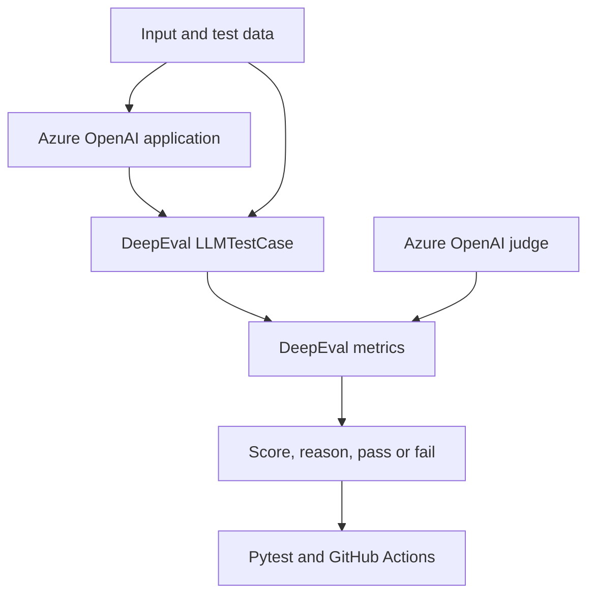

# LLM Testing and Evaluation with DeepEval and Azure OpenAI

[](https://github.com/ashokmanohar-ai/deepeval-llm-testing/actions/workflows/llm-tests.yml)
[](https://www.python.org/)
[](https://pypi.org/project/deepeval/4.1.7/)
[](LICENSE)

A production-friendly, beginner-readable starter repository for automated LLM unit testing,
RAG evaluation, custom LLM-as-a-judge rubrics, and AI-agent evaluation. Azure OpenAI is used
both as the application LLM in the live example and as DeepEval's judge model.

> **API verification:** Last verified on **11 August 2026** against **DeepEval 4.1.7** and the
> current official DeepEval documentation. This project uses `SingleTurnParams`,
> `AzureOpenAIModel`, `AnswerRelevancyMetric`, `FaithfulnessMetric`, `HallucinationMetric`,
> `GEval`, `ToolCorrectnessMetric`, and trace-based `TaskCompletionMetric`. LLM evaluation tools
> evolve quickly; review the linked official documentation before upgrading the pinned version.

## What you will learn

- Turn qualitative LLM behavior into repeatable `pytest` quality gates.
- Connect DeepEval to Azure OpenAI without committing credentials.
- Evaluate relevant, irrelevant, correct, partial, grounded, and hallucinated answers.
- Test a RAG generator with answer relevancy, faithfulness, and curated-context hallucination.
- Create G-Eval rubrics for correctness, completeness, professionalism, clarity, helpfulness,
  and overall response quality.
- Evaluate agent tool selection, arguments, grounding, final outcomes, and multi-step traces.
- Keep intentional failing examples available without making the normal CI pipeline permanently red.
- Calibrate thresholds using labeled application data instead of copying arbitrary values.

## What is DeepEval?

[DeepEval](https://deepeval.com/docs/introduction) is an open-source evaluation framework for
LLM applications. It provides test-case objects, model-based and deterministic metrics, datasets,
tracing, result explanations, and a Pytest-compatible test runner. Think of it as a quality-testing
toolkit designed for outputs whose wording can change even when the meaning is acceptable.

Traditional unit tests are still essential. They are excellent for deterministic behavior such as:

```python
assert response.status_code == 200
assert payload["customer_id"] == "C-100"
```

They are less suitable for judging two valid natural-language answers:

```text
"Returns are accepted for 30 days."
"You may return the item within thirty calendar days."
```

An exact string comparison says these differ. An LLM evaluation asks whether both satisfy a defined
quality requirement. A mature test strategy uses both: deterministic assertions for contracts and
LLM-aware metrics for meaning and quality.

## Why LLM testing is different

| Traditional software behavior | LLM application behavior |
| --- | --- |
| Usually deterministic for the same input | May vary across runs, models, prompts, and deployments |
| Expected value is often exact | Several phrasings may all be acceptable |
| Failure is usually binary | Quality often exists on a continuum |
| Code is the main dependency | Prompt, model, context, retriever, tools, and judge all affect behavior |
| An assertion explains the mismatch | A metric should provide both a score and a reason |

LLM-as-a-judge is useful, but it is not an objective oracle. Judge outputs can vary and inherit model
biases. Use representative human-labeled data, explicit rubrics, stable judge deployments, repeated
runs where risk warrants them, and deterministic checks for non-negotiable rules.

## Repository architecture



Generation and judging are separate on purpose. `llm_service.py` calls the application deployment;
`azure_openai_client.py` constructs the judge passed into DeepEval metrics. In production, use a
separate judge deployment when independent evaluation and access controls matter.

See [the architecture guide](docs/architecture.md) for component responsibilities and agent layers.

## Project structure

```text
deepeval-llm-testing/
├── .github/
│   ├── dependabot.yml
│   └── workflows/llm-tests.yml
├── data/evaluation_cases.json
├── docs/
│   ├── architecture.md
│   └── metrics.md
├── examples/
│   ├── agent_evaluation.py
│   ├── basic_evaluation.py
│   ├── custom_geval.py
│   ├── live_generation_evaluation.py
│   └── rag_evaluation.py
├── scripts/validate_repository.py
├── src/deepeval_llm_testing/
│   ├── agent/mock_agent.py
│   ├── evaluation/
│   │   ├── agent_evaluation.py
│   │   ├── faithfulness.py
│   │   ├── geval.py
│   │   ├── hallucination.py
│   │   └── relevancy.py
│   ├── azure_openai_client.py
│   ├── config.py
│   ├── dataset.py
│   ├── llm_service.py
│   └── reporting.py
├── tests/
│   ├── expected_failures/
│   ├── conftest.py
│   └── test_*.py
├── .env.example
├── pyproject.toml
├── requirements.txt
└── README.md
```

## Installation

### 1. Clone and enter the repository

```bash
git clone https://github.com/ashokmanohar-ai/deepeval-llm-testing.git
cd deepeval-llm-testing
```

### 2. Create a virtual environment

```bash
python -m venv .venv
```

Activate it on Windows PowerShell:

```powershell
.venv\Scripts\Activate.ps1
```

Activate it on Windows Command Prompt:

```bat
.venv\Scripts\activate.bat
```

Activate it on macOS or Linux:

```bash
source .venv/bin/activate
```

### 3. Install dependencies and the local package

```bash
python -m pip install --upgrade pip
pip install -r requirements-dev.txt
pip install --no-deps -e .
```

For runtime-only use:

```bash
pip install -r requirements.txt
pip install --no-deps -e .
```

## Azure OpenAI configuration

Copy the template:

```bash
# macOS/Linux/Git Bash
cp .env.example .env
```

```powershell
# Windows PowerShell
Copy-Item .env.example .env
```

Edit `.env`:

```dotenv
AZURE_OPENAI_API_KEY=your-api-key
AZURE_OPENAI_ENDPOINT=https://your-resource.openai.azure.com/
AZURE_OPENAI_API_VERSION=2025-01-01-preview
AZURE_OPENAI_DEPLOYMENT_NAME=your-deployment-name
AZURE_OPENAI_MODEL_NAME=gpt-4.1
AZURE_OPENAI_TEMPERATURE=0
DEEPEVAL_TELEMETRY_OPT_OUT=1
```

The four required variables are:

| Variable | Meaning |
| --- | --- |
| `AZURE_OPENAI_API_KEY` | Secret key for the Azure OpenAI resource |
| `AZURE_OPENAI_ENDPOINT` | Resource endpoint ending in `openai.azure.com/` |
| `AZURE_OPENAI_API_VERSION` | Azure API version supported by the resource |
| `AZURE_OPENAI_DEPLOYMENT_NAME` | Azure deployment name used in requests |

`AZURE_OPENAI_MODEL_NAME` is optional and identifies the underlying model family to DeepEval.
When omitted, the deployment name is used. DeepEval's current Azure documentation says the API
version must be at least `2024-08-01-preview` for structured-output support. Confirm a supported
version for your Azure resource rather than assuming the sample value is available everywhere.

### How Azure OpenAI connects to DeepEval

The reusable factory passes explicit project settings to DeepEval's native model wrapper:

```python
from deepeval.models import AzureOpenAIModel

judge = AzureOpenAIModel(
    model=settings.model_name,
    deployment_name=settings.deployment_name,
    api_key=settings.api_key,
    base_url=settings.endpoint,
    api_version=settings.api_version,
    temperature=0,
)
```

Metric factories receive that judge:

```python
metric = AnswerRelevancyMetric(
    threshold=0.7,
    model=judge,
    include_reason=True,
)
```

This explicit approach is preferable for reusable application code because it does not depend on a
developer's machine-level DeepEval settings. DeepEval also supports global CLI configuration with
`deepeval set-azure-openai`; see the [official model configuration documentation](https://deepeval.com/docs/metrics-introduction).

## Running checks and tests

### Fast repository validation

This requires only Python's standard library and checks structure, syntax, dataset coverage,
`.env` hygiene, and probable committed Azure keys:

```bash
python scripts/validate_repository.py
```

### Deterministic tests only

These do not call an LLM and do not incur Azure cost:

```bash
pytest -m "not azure"
```

### Complete DeepEval test suite

After configuring Azure OpenAI:

```bash
deepeval test run tests
```

The [official DeepEval test runner](https://deepeval.com/docs/evaluation-unit-testing-in-ci-cd)
is built on Pytest and adds evaluation-oriented reporting and run features. Plain Pytest also works:

```bash
pytest
```

Azure-marked cases are skipped when credentials are absent. That makes forks and local static checks
safe, but it is not equivalent to running the quality gate. Configure all four secrets in CI to run
the live evaluations.

### Cache unchanged evaluations

```bash
deepeval test run tests -c
```

Caching reduces repeated judge calls while iterating. Do not mistake a cached result for proof that a
new model, prompt, dataset, or metric version was evaluated.

### Intentional failing examples

The red tests are under `tests/expected_failures/` and are excluded from normal test collection.
They demonstrate what a failing quality gate looks like without breaking every routine CI run.

Run them explicitly and expect a non-zero exit code:

```bash
pytest tests/expected_failures -o addopts="" -v
```

The folder includes:

- a wrong-tool agent failure that is deterministic;
- an irrelevant answer;
- a hallucinated answer; and
- an unfaithful RAG answer.

## LLM unit testing pattern

The basic DeepEval assertion is intentionally small:

```python
from deepeval import assert_test
from deepeval.metrics import AnswerRelevancyMetric
from deepeval.test_case import LLMTestCase

test_case = LLMTestCase(
    input="What is Azure OpenAI?",
    actual_output=response,
)
metric = AnswerRelevancyMetric(
    threshold=0.7,
    model=azure_judge,
    include_reason=True,
)

assert_test(test_case, [metric], run_async=False)
```

`tests/test_llm_unit.py` first calls Azure OpenAI through the application service, then evaluates the
fresh response through an independent DeepEval metric. The remaining metric tests mostly use frozen,
labeled responses so regressions are easier and cheaper to reproduce.

## Understanding the metrics

| Metric | Purpose | Required test-case data | Passing direction | Example threshold |
| --- | --- | --- | --- | --- |
| Answer relevancy | Does the answer address the question? | `input`, `actual_output` | Score ≥ threshold | 0.70 |
| Faithfulness | Is the answer supported by retrieved RAG content? | `input`, `actual_output`, `retrieval_context` | Score ≥ threshold | 0.80 |
| Hallucination | Does the answer contradict curated ground truth? | `input`, `actual_output`, `context` | **Score ≤ threshold** | 0.20 |
| G-Eval | Does the output satisfy a custom rubric? | Parameters named by the rubric | Score ≥ threshold | 0.75 |
| Tool correctness | Did the agent use expected tools correctly? | `tools_called`, `expected_tools` | Score ≥ threshold | 1.00 |
| Task completion | Did the complete observed agent run accomplish the task? | A traced agent trajectory | Score ≥ threshold | 0.75 |

These values are teaching examples, not universal production defaults. See the
[detailed metric guide](docs/metrics.md) for calculation concepts, interpretation, use cases,
common mistakes, and calibration steps.

## RAG evaluation example

The sample RAG question is:

```text
Question: What is the company's refund policy?

Retrieval context:
Unopened electronics can be returned within 30 calendar days of delivery.
A receipt or order number is required.

Generated answer:
Unopened electronics may be returned within 30 days of delivery when the
customer provides a receipt or order number.
```

Run all three generator-oriented checks:

```bash
python examples/rag_evaluation.py
```

### Relevancy, faithfulness, and hallucination are not interchangeable

| Question | Metric |
| --- | --- |
| Did the answer address what the user asked? | Answer relevancy |
| Did the answer stay consistent with what the retriever actually returned? | Faithfulness |
| Did the answer contradict a curated ground-truth reference? | Hallucination |

In DeepEval, `context` represents ideal or ground-truth reference material, while
`retrieval_context` represents the content the application actually retrieved. A RAG answer can be
faithful to bad retrieval and still be wrong in the real world. Evaluate retrieval quality separately
when that distinction matters.

## G-Eval: custom evaluation criteria

The repository's **Professional Answer Quality** rubric checks:

- correctness;
- completeness;
- professionalism;
- clarity;
- helpfulness; and
- overall response quality.

Run it:

```bash
python examples/custom_geval.py
```

Create a narrower custom rubric when one aggregate score would hide the root cause:

```python
from deepeval.test_case import SingleTurnParams

metric = build_custom_geval_metric(
    name="Troubleshooting Helpfulness",
    criteria=(
        "The response should identify the likely cause, provide safe ordered steps, "
        "state the expected result, and explain when to escalate."
    ),
    evaluation_params=[
        SingleTurnParams.INPUT,
        SingleTurnParams.ACTUAL_OUTPUT,
        SingleTurnParams.EXPECTED_OUTPUT,
    ],
    model=azure_judge,
    threshold=0.8,
)
```

Only include evaluation parameters that the criteria actually uses. `SingleTurnParams` is the
current DeepEval 4 API; `LLMTestCaseParams` is a deprecated compatibility alias.

## Agent evaluation example

The mock refund agent runs locally and has no external tool dependency:

1. Classify the request.
2. Select `knowledge_base_search`.
3. Call the mock policy tool.
4. Use the returned policy in the final answer.

Run the full example:

```bash
python examples/agent_evaluation.py
```

It evaluates four distinct concerns:

| Concern | Metric or mechanism |
| --- | --- |
| Correct tool and arguments | Deterministic `ToolCorrectnessMetric` |
| Correct use of the tool result | `FaithfulnessMetric` |
| Relevant, complete final response | Custom agent-outcome `GEval` |
| Successful multi-step workflow | Tracing plus `TaskCompletionMetric` |

DeepEval 4.1.7 task completion evaluates the full observed trace. The example uses `@observe()` and
`EvaluationDataset.evals_iterator(metrics=[...])`, matching the current trajectory-based API.

### Reasoning outcomes, not hidden reasoning text

Good agent evaluation checks observable plans, tool choices, arguments, results, state transitions,
and final outcomes. It should not require private chain-of-thought. This repository's outcome rubric
explicitly judges observable evidence only.

## Sample dataset

`data/evaluation_cases.json` contains ten fictional, version-controlled scenarios:

- correct and relevant answer;
- irrelevant answer;
- partially correct answer;
- hallucinated answer;
- faithful RAG answer;
- unfaithful RAG answer;
- high-quality professional answer;
- poorly written answer;
- successful agent task; and
- failed agent task.

Treat this as a schema example. A production evaluation set should represent real user intents,
languages, risk levels, edge cases, prompt attacks, empty retrieval, tool failures, and known incidents.
Keep a held-out set to reduce overfitting prompts to the visible regression data.

## Key distinctions

### Relevancy vs correctness

Relevancy asks whether the answer addresses the question. Correctness asks whether the content is
factually right, often relative to expected output or reference facts. A relevant answer can still be
wrong; an accurate fact can still be irrelevant.

### Faithfulness vs hallucination

Faithfulness uses the RAG system's actual `retrieval_context`. Hallucination uses curated `context` as
ground truth and is lower-is-better in DeepEval. Use faithfulness to diagnose the generator in a RAG
pipeline and hallucination when reviewed reference facts are available.

### Deterministic tests vs LLM-as-a-judge

Deterministic assertions are cheap, fast, repeatable, and ideal for schemas, tool contracts,
allowlists, citations, and exact business rules. LLM judges handle semantics and subjective quality
but cost money and can vary. Layer them instead of choosing only one.

### RAG evaluation vs general LLM evaluation

General evaluation may need only input and output. RAG evaluation adds retrieval evidence and often
separates retriever quality from generator quality. A complete RAG program commonly measures
contextual precision, recall, and relevancy in addition to response metrics.

### Response evaluation vs agent evaluation

Response evaluation treats the system as a black box. Agent evaluation also inspects the path:
tool choice, arguments, intermediate results, ordering, efficiency, handoffs, and task completion.

## GitHub Actions CI/CD

`.github/workflows/llm-tests.yml`:

1. checks out the repository;
2. installs Python 3.12;
3. installs pinned runtime and development dependencies;
4. validates structure and secret hygiene;
5. runs Ruff;
6. runs deterministic Pytest checks; and
7. runs the DeepEval test suite.

### Configure GitHub secrets

In the repository, open **Settings → Secrets and variables → Actions → New repository secret** and
add:

- `AZURE_OPENAI_API_KEY`
- `AZURE_OPENAI_ENDPOINT`
- `AZURE_OPENAI_API_VERSION`
- `AZURE_OPENAI_DEPLOYMENT_NAME`
- `AZURE_OPENAI_MODEL_NAME` (optional but recommended)

Secrets are passed to the job environment and are never echoed. Pull requests from forks do not
receive repository secrets; Azure tests will skip in that situation. Use protected environments and
approval gates if evaluation data or model access is sensitive.

The workflow also sets `DEEPEVAL_TELEMETRY_OPT_OUT=1`, the documented DeepEval setting that disables
anonymous PostHog telemetry. The `.env.example` applies the same privacy default locally.

For strict internal CI, add a preliminary step that fails when required Azure variables are empty.
This starter chooses safe skipping so the public repository remains usable without credentials.

## Security checklist

- `.env` and `.env.local` are ignored; only `.env.example` is committed.
- No credentials are hard-coded or printed.
- GitHub Actions reads Azure values from repository secrets.
- The validator scans for probable committed Azure keys.
- Sample data is fictional.
- Evaluation inputs, contexts, traces, outputs, and reasons should all be classified as application data.
- Optional Confident AI cloud reporting is not required and is not configured by this repository.
- Apply Azure least privilege, key rotation, private networking, content-filtering, quotas, and budget
  controls according to your organization's policies.

If a key is committed, revoke or rotate it first; removing it from the latest commit is not enough
because Git history and forks may still contain it.

## Production recommendations

1. **Version the whole evaluation contract.** Track dataset, prompts, model deployment, metric,
   judge model, threshold, and code revision together.
2. **Calibrate against human labels.** Measure false passes and false failures before creating a gate.
3. **Separate blocking and diagnostic metrics.** A dashboard signal need not immediately block deploys.
4. **Use a review band.** Send borderline results to humans instead of forcing brittle automation.
5. **Control cost.** Use frozen outputs, small smoke suites, caching, concurrency limits, and scheduled
   full runs.
6. **Test failures.** Include timeouts, empty context, malformed tool results, unavailable tools, and
   judge errors.
7. **Watch drift.** Recalibrate after model, prompt, retrieval, policy, or judge changes.
8. **Keep deterministic guardrails.** Never delegate exact security and policy checks solely to an LLM.

## Troubleshooting

### Azure returns 401 or 403

Check the key, endpoint, deployment permissions, resource network policy, and whether key-based
authentication is enabled. Do not paste real credentials into issues or logs.

### Azure returns 404

Confirm `AZURE_OPENAI_DEPLOYMENT_NAME` is the Azure **deployment name**, not merely the model family,
and confirm the endpoint belongs to the same resource.

### Structured-output or JSON errors

Confirm the configured Azure API version meets DeepEval's documented minimum and that the deployed
judge model supports the features required by the metric.

### Scores vary between runs

LLM-as-a-judge metrics are nondeterministic. Pin model deployments, use temperature 0 where supported,
make criteria specific, consider explicit G-Eval steps/rubrics, repeat borderline cases, and compare
against human labels.

### Tests are skipped

Run `pytest -ra` to see skip reasons. Azure tests skip when any required environment variable is absent
or still contains a placeholder.

## Official references

- [DeepEval introduction](https://deepeval.com/docs/introduction)
- [DeepEval 5-minute quickstart](https://deepeval.com/docs/getting-started)
- [Azure OpenAI judge configuration](https://deepeval.com/docs/metrics-introduction)
- [Answer relevancy](https://deepeval.com/docs/metrics-answer-relevancy)
- [Faithfulness](https://deepeval.com/docs/metrics-faithfulness)
- [Hallucination](https://deepeval.com/docs/metrics-hallucination)
- [G-Eval](https://deepeval.com/docs/metrics-llm-evals)
- [Tool correctness](https://deepeval.com/docs/metrics-tool-correctness)
- [Task completion](https://deepeval.com/docs/metrics-task-completion)
- [Unit testing in CI/CD](https://deepeval.com/docs/evaluation-unit-testing-in-ci-cd)
- [DeepEval source repository](https://github.com/confident-ai/deepeval)

## License

This project is available under the [MIT License](LICENSE).
