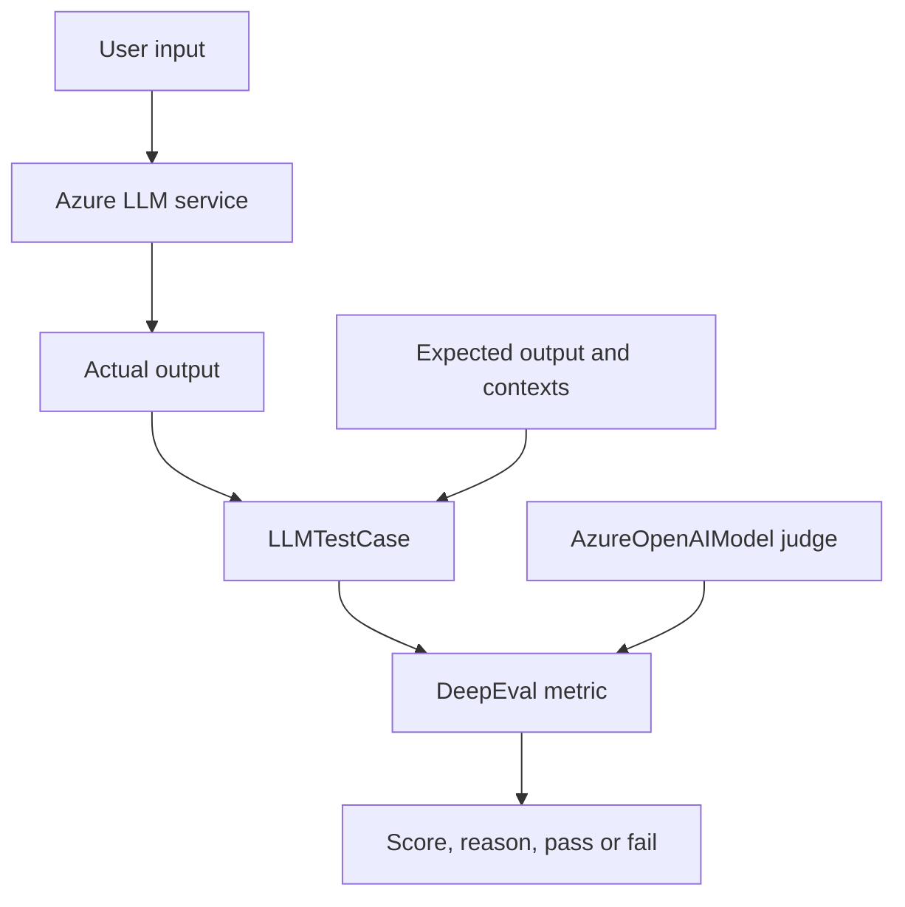

# Architecture

The project deliberately separates the system being tested from the system judging it.
That separation prevents tests from accidentally evaluating a hard-coded sample instead of
the real application call.

## Responsibilities

| Component | Responsibility |
| --- | --- |
| `config.py` | Load and validate configuration without logging secrets |
| `llm_service.py` | Generate application responses through Azure OpenAI |
| `azure_openai_client.py` | Create DeepEval's Azure judge model |
| `evaluation/` | Define reusable metric policies and thresholds |
| `dataset.py` | Load version-controlled test cases |
| `agent/mock_agent.py` | Provide a local tool-using workflow for agent tests |
| `reporting.py` | Expose score, reason, threshold, and pass/fail consistently |
| `tests/` | Turn quality policies into automated gates |

## Test data flow

1. A test selects a labeled evaluation case.
2. The application may generate a fresh response, or the test may use a frozen regression output.
3. The test constructs an `LLMTestCase` with only the parameters needed by its metric.
4. The metric calls the Azure OpenAI judge where necessary.
5. DeepEval compares the score with the configured threshold and `assert_test()` fails the test
   when the quality gate is not met.

## Agent evaluation layers

| Layer | What it answers | Implementation |
| --- | --- | --- |
| Tool selection | Did the agent call the expected tool with the expected arguments? | `ToolCorrectnessMetric` |
| Grounding | Did the final response stay within the tool/retrieval result? | `FaithfulnessMetric` |
| Outcome quality | Was the final response correct, relevant, useful, and complete? | Custom `GEval` |
| Workflow outcome | Did the observed multi-step run accomplish the task? | Trace-based `TaskCompletionMetric` |

The project evaluates observable decisions, calls, outputs, and traces. It does not ask for or
store hidden chain-of-thought.

